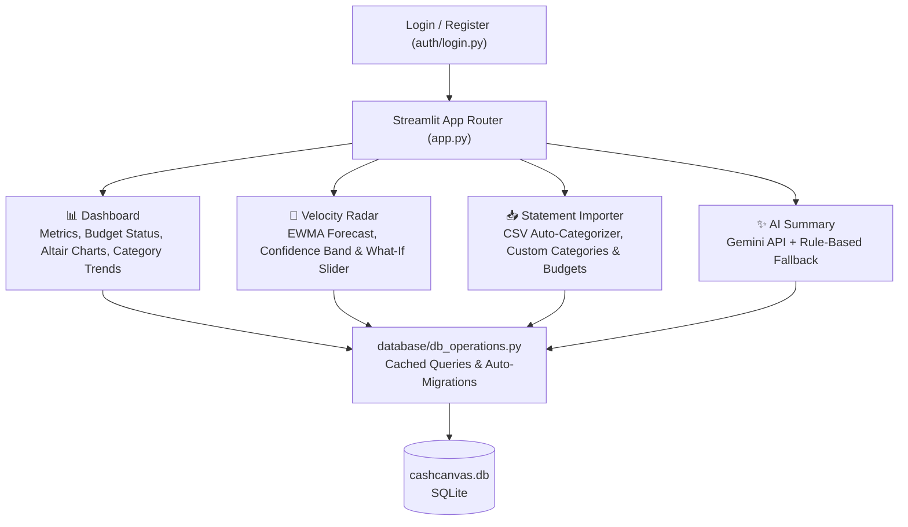

# 💸 CashCanvas

**Proactive Personal Finance Tracker with Bank Statement Importing, EWMA Spending Velocity Radar, What-If Simulation & Gemini AI Monthly Summaries**

[](https://www.python.org/)
[](https://streamlit.io/)
[](https://www.sqlite.org/)
[](https://altair-viz.github.io/)
[](https://ai.google.dev/)

---

## 📖 Overview

Most expense trackers are purely retrospective—they tell you what you already spent after your balance is depleted. **CashCanvas** turns expense tracking into a proactive financial dashboard built in Python and Streamlit.

Instead of only logging historical transactions, CashCanvas calculates your rolling **Exponentially Weighted Moving Average (EWMA)** daily burn rate, projects your month-end expenditure against saved budgets, tracks per-category spending momentum, lets you bulk-import bank statements via CSV with automatic categorization, and generates plain-English monthly recaps using the **Google Gemini API** (with an automatic offline fallback).

---

## ✨ Key Features

| Module | Capabilities |
|---|---|
| **🔐 Secure User Authentication** | Account registration and login with `bcrypt` password hashing and strict `user_id` data isolation in SQLite. |
| **📊 Interactive Dashboard** | KPI summary cards (Total Spend, Transaction Count, Average Expense, Top Category), smart trend insight banner, recent transactions ledger, and a 4-chart interactive Altair selector paired with synchronized data tables. |
| **💰 Category Budget Tracker** | Per-category monthly limits with visual progress bars, remaining/over-budget calculations, and live status alerts (*On track*, *Approaching limit*, *Limit reached*, *Over budget*). |
| **📥 Bank Statement CSV Importer** | Upload `.csv` bank statements with flexible column auto-detection (Date, Description, Amount), regex keyword-based auto-categorization, Income vs. Expense detection, preview table, and one-click bulk SQLite insertion (includes `sample_bank_statement.csv`). |
| **🏷️ Custom Categories & Yearly Budgets** | 19 built-in normalized expense categories plus custom user-defined categories and year-based category budget configuration. |
| **🚦 Spending Velocity Radar** | Forecasts month-end cumulative spending using EWMA burn rate with a confidence corridor, supporting both **Overall Budget** and **Category Budget** scopes plus a Forecast vs. Budget comparison bar chart. |
| **🎛️ Live What-If Simulator** | Interactive slider (`-100%` to `+50%` in 5% steps) that adjusts projected future daily burn rate and redraws the forecast and uncertainty band in real time without modifying historical spending. |
| **📈 Category Trend Detection** | Compares each category's latest 7-day EWMA against its daily average to flag spending velocity as `🔺 Increasing`, `⚪ Stable`, or `🟢 Decreasing`. |
| **✨ AI Monthly Summary** | On-demand monthly financial recaps powered by `google-genai` with automatic model discovery (prioritizing stable Gemini Flash models), session caching, and a rule-based offline fallback when no API key is configured. |
| **🐳 Dev Container Ready** | Includes `.devcontainer/devcontainer.json` for instant setup in VS Code Dev Containers or GitHub Codespaces. |

---

## 🧠 How the Analytics & Forecasting Work

### 1. EWMA Spending Velocity
CashCanvas computes your recent daily burn rate using an Exponentially Weighted Moving Average (`span=7`, `adjust=False`), giving higher weight to recent spending activity so sudden spikes are detected early:

```text
EWMA(t) = α · DailySpend(t) + (1 - α) · EWMA(t - 1),   where α = 2 / (span + 1)
Projected Month-End Spend = Current Cumulative Spend + (EWMA Burn Rate × Remaining Days)
```

### 2. What-If Simulation & Confidence Corridor
When you adjust the What-If slider (`adjustment_pct`), only future days after the as-of date are recalculated:

```text
Adjusted Rate = max(0, Base EWMA Rate × (1 + adjustment_pct / 100))
Forecast(d)   = Current Cumulative Spend + (Adjusted Rate × d)
```

Upper and lower confidence bands widen with $\sqrt{d}$ across remaining days to reflect growing forecast uncertainty.

### 3. Bank Statement Auto-Categorization
`modules/csv_importer.py` automatically detects standard bank export headers (`date`/`txn_date`/`value_date`, `desc`/`narration`/`particulars`, `amount`/`debit`/`withdrawal`) and maps descriptions using keyword matching across **Food**, **Transport**, **Shopping**, **Entertainment**, **Utilities**, **Health**, **Income**, and **Miscellaneous**.

---

## 🏗️ Architecture & Project Structure

```text
Cash-Canvas/
├── app.py                          # Main Streamlit app, router, and authenticated views
├── requirements.txt                # Python dependencies
├── sample_bank_statement.csv       # Sample CSV for testing Statement Importer
├── .devcontainer/
│   └── devcontainer.json           # VS Code Dev Container / Codespaces config
├── auth/
│   ├── __init__.py
│   └── login.py                    # Login & registration UI with bcrypt hashing
├── database/
│   ├── __init__.py
│   ├── db_setup.py                 # Base SQLite schema initializer
│   └── db_operations.py            # Auto-migrating SQLite CRUD, caching & category normalization
├── modules/
│   ├── __init__.py
│   ├── ai_summarizer.py            # Gemini API integration, model discovery & offline fallback
│   ├── altair_charts.py            # Dark-themed interactive Altair charts (₹ formatted)
│   ├── csv_importer.py             # Bank statement CSV parser & regex auto-categorizer
│   ├── forecasting.py              # EWMA burn rate, velocity trajectory & category trends
│   ├── visualizations.py           # Matplotlib & Seaborn static chart utilities
│   └── whatif_simulator.py         # Real-time What-If forecast adjustment engine
├── views/
│   ├── __init__.py
│   ├── statement_uploader.py       # CSV uploader, yearly category budgets & custom categories UI
│   └── velocity_radar.py           # Velocity Radar view & forecast table formatter
├── docs/                           # Project documentation assets
└── tests/
    └── README.md                   # Hackathon specification & QA checklist
```

### Application Flow



---

## 🗄️ Database Design

CashCanvas uses a local SQLite database (`cashcanvas.db`) that initializes and migrates tables automatically via `init_db()` and `initialize_database()`:

- **`users`** — User accounts and `bcrypt` password hashes.
- **`transactions`** — Per-user transaction records (`txn_date`, `description`, `amount`, `category`, `type`).
- **`category_budgets` / `yearly_category_budgets` / `monthly_budgets` / `user_budgets`** — Granular monthly and yearly spending limits per category.
- **`custom_categories`** — User-created expense categories extending the 19-category default catalog.

Read queries use `@st.cache_data(ttl=60)` and automatically clear cache on any write operation.

---

## 🛠️ Tech Stack

| Layer | Technologies |
|---|---|
| **Frontend & App Framework** | Python, Streamlit |
| **Data & Statistics** | Pandas, NumPy |
| **Interactive Visualizations** | Altair (Vega-Lite) |
| **Static Charts** | Matplotlib, Seaborn |
| **Database** | SQLite (`sqlite3`) |
| **Authentication & Config** | `bcrypt`, `python-dotenv` |
| **Generative AI** | Google Gemini (`google-genai`) |
| **Testing & DevOps** | `pytest`, VS Code Dev Containers |

---

## 🚀 Getting Started

### Prerequisites
- Python **3.10+**
- Git
- *(Optional)* A **Google Gemini API key** — if omitted, CashCanvas automatically uses its built-in rule-based summary generator.

### 1. Clone the repository
```bash
git clone [https://github.com/abdulkhadersyed11/Cash-Canvas.git](https://github.com/abdulkhadersyed11/Cash-Canvas.git)
cd Cash-Canvas
```

### 2. Create and activate a virtual environment

**macOS / Linux:**
```bash
python3 -m venv venv
source venv/bin/activate
```

**Windows (PowerShell):**
```powershell
python -m venv venv
.\venv\Scripts\Activate.ps1
```

### 3. Install dependencies
```bash
pip install --upgrade pip
pip install -r requirements.txt
```

### 4. Configure environment variables *(Optional for AI Summary)*
Create a `.env` file in the project root:
```env
GEMINI_API_KEY=your_gemini_api_key_here
GEMINI_MODEL=
```
> **Note:** Leave `GEMINI_MODEL` blank to let CashCanvas automatically discover and select the best available Gemini Flash model, or omit `.env` entirely to use the offline fallback summary. Never commit `.env` to version control.

### 5. Initialize the database
```bash
python database/db_setup.py
```

### 6. Run the app
```bash
streamlit run app.py
```
Open `http://localhost:8501` in your browser.

---

## 📋 Quick Usage Guide

1. **Create an Account & Sign In** using the Login/Register tabs.
2. **Import Transactions & Set Budgets:** Open **Statement Importer** in the sidebar to upload your bank statement CSV (or test immediately with `sample_bank_statement.csv`), add any custom categories, and set monthly category targets for the selected year.
3. **Inspect Spending on the Dashboard:** Review KPI cards, category budget progress bars, recent expenses, category velocity trends, and switch between the 4 interactive Altair charts.
4. **Forecast with Velocity Radar:** Choose a month and toggle between **Overall Budget** or **Category Budget**, then slide the **What-If** percentage control to simulate reducing or increasing daily spending.
5. **Generate an AI Monthly Summary:** Select a month in **AI Summary** and click **Generate AI Summary** for an instant natural-language recap.

---

## 📝 Project Changelog

- **Initial Release (`Aug 2026`)** — Built core CashCanvas application: `bcrypt` authentication, SQLite schema, interactive Dashboard, Altair & Matplotlib visualizations, EWMA forecasting, What-If simulator, and Gemini AI summarizer with offline fallback.
- **Documentation Update (`Aug 2026`)** — Added structured project architecture and algorithm documentation.
- **Dev Container Integration (`Sep 2026`)** — Added `.devcontainer/devcontainer.json` for reproducible containerized development.
- **Major Feature & Stability Upgrade (`Sep 2026`)** — Introduced **Bank Statement CSV Importer** (`modules/csv_importer.py`, `views/statement_uploader.py`, `sample_bank_statement.csv`) with keyword auto-categorization, custom category creation, yearly/monthly category budget management, automatic SQLite schema migrations with Streamlit caching, resilient zero-transaction forecasting, and enhanced Altair Velocity Radar charts.
- **App Maintenance (`Nov 2026`)** — Updated `app.py` application routing and display behavior.

---

*Built by [Syed Abdul Khader](https://github.com/abdulkhadersyed11) for the Computer Science Mini Project & Samsung Innovation Campus Program.*